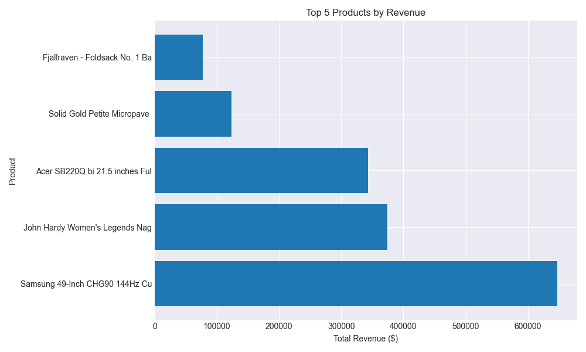
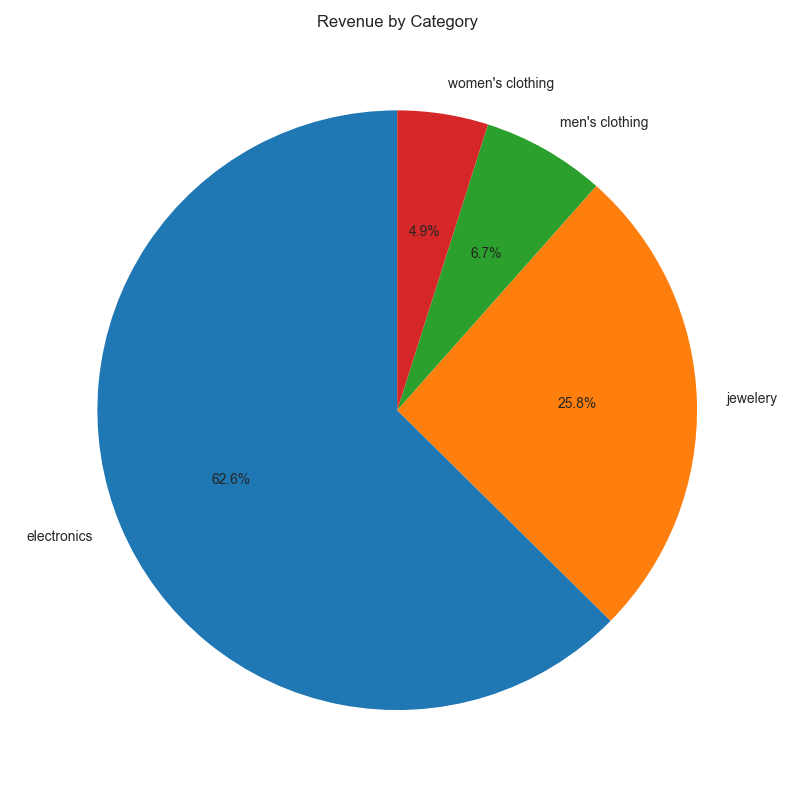
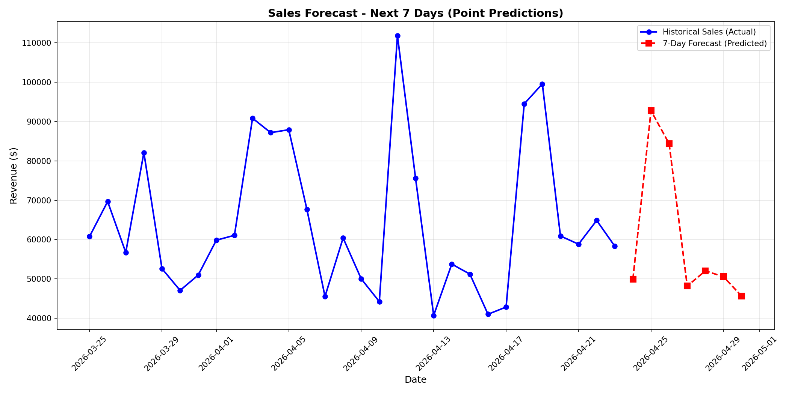

# 📊 Retail Intelligence Platform

An end-to-end retail analytics and sales forecasting platform built using **Python, MySQL, SQL, Machine Learning, and Streamlit**. The platform transforms retail sales data into meaningful business insights through data processing, analytical queries, interactive visualizations, and sales forecasting.

**GitHub Repository:** [Retail Intelligence Platform](https://github.com/AditiGem/retail-intelligence-platform)

---

## 📌 Project Overview

Retail businesses generate large amounts of data across products, categories, cities, and transactions. Analyzing this data helps businesses understand sales performance, identify top-performing products, monitor revenue trends, and make informed decisions.

The Retail Intelligence Platform provides an integrated analytics solution using Python for data processing, MySQL for database management, SQL for business analysis, and Machine Learning for sales forecasting.

An interactive Streamlit dashboard brings these components together and presents the results through KPIs, charts, filters, and forecasting insights.

## 🎯 Project Objectives

- Analyze overall retail sales performance.
- Monitor important business KPIs.
- Identify top-performing products and categories.
- Analyze city-wise revenue distribution.
- Understand daily and monthly sales trends.
- Forecast future sales using machine learning.
- Present actionable insights through an interactive dashboard.

## 🛠️ Technology Stack

| Category | Technologies |
|---|---|
| Programming Language | Python |
| Database | MySQL 8.0 |
| Data Processing | Pandas, NumPy |
| Machine Learning | Scikit-learn |
| Data Visualization | Plotly, Matplotlib |
| Dashboard | Streamlit |
| Database Connectivity | mysql-connector-python |
| Environment Management | python-dotenv |
| Version Control | Git, GitHub |

## 🏗️ Project Architecture

The platform follows an end-to-end data analytics workflow:

1. **Data Source:** Retail sales data is used as the input.
2. **ETL Pipeline:** Python processes, cleans, and prepares the data.
3. **Database:** Processed data is stored and accessed through MySQL.
4. **SQL Analytics:** Analytical queries extract business insights.
5. **Machine Learning:** A Random Forest Regression model forecasts future sales.
6. **Dashboard:** Streamlit presents KPIs, visualizations, and forecasting results.

```text
             Retail Sales Data
                    |
                    v
          Python ETL Pipeline
          (Pandas / NumPy)
                    |
                    v
              MySQL Database
                    |
          +---------+---------+
          |                   |
          v                   v
     SQL Analytics       Forecasting Model
     (10 Queries)        (Random Forest)
          |                   |
          +---------+---------+
                    |
                    v
          Streamlit Dashboard
                    |
                    v
          Business Insights
```

## ✨ Key Features

### 1. Executive Dashboard

An interactive dashboard providing an overview of retail business performance through six key performance indicators:

- Total Revenue
- Total Orders
- Average Order Value (AOV)
- Units Sold
- Sales Growth Percentage
- Forecast Revenue

### 2. Sales Analytics

- Daily revenue trend analysis.
- Revenue growth monitoring.
- Monthly revenue analysis.
- Category-wise sales performance.
- City-wise revenue comparison.

### 3. Product Analytics

- Top 10 products based on revenue.
- Product performance comparison.
- Category contribution analysis.
- Identification of high-performing products.

### 4. Geographic Analytics

- City-wise revenue analysis.
- Comparison of sales performance across locations.
- Identification of top-performing cities.

### 5. SQL Analytics

The project includes 10 analytical SQL queries demonstrating practical SQL concepts such as aggregations, Common Table Expressions (CTEs), window functions, ranking, and data analysis.

| No. | SQL Analysis |
|---|---|
| 01 | Monthly Revenue |
| 02 | Revenue Growth |
| 03 | Top Products |
| 04 | Category Performance |
| 05 | City Performance |
| 06 | Average Order Value by Month |
| 07 | Transaction Patterns |
| 08 | Running Revenue |
| 09 | Month-over-Month Growth |
| 10 | Product Ranking |

### 6. Sales Forecasting

A Random Forest Regression model is implemented to predict future sales using historical sales patterns and time-based features.

**Forecasting methodology:**

- Lag-based feature engineering.
- Rolling statistical features.
- Time-based features such as day of the week and month.
- Chronological training and testing split.
- Recursive multi-step forecasting.
- Model evaluation using R², MAE, and RMSE.

**Model Evaluation Results**

| Metric | Result |
|---|---:|
| Training Samples | 19 daily observations |
| Testing Samples | 5 daily observations |
| Test R² Score | 0.41 |
| MAE | 66 units (17.1%) |
| RMSE | 68 units (17.6%) |

The model generates point forecasts without claiming unsupported statistical prediction intervals.

*Note: The model was evaluated on a limited dataset. Its performance should be interpreted with this limitation in mind.*

---

## 📸 Dashboard Screenshots

### Product Performance Analysis

Explore top-performing products and compare their revenue contribution.



### Category Revenue Analysis

Understand revenue distribution across different product categories.



### Sales Forecasting

Explore future sales predictions, model evaluation metrics, and important forecasting features.



*Additional visualizations for city-wise revenue, daily revenue trends, and payment methods are available as PNG files in the repository.*

---

## 📂 Project Structure

```text
retail-intelligence-platform/
│
├── config.py
├── pipeline.py
├── retail_platform.py
├── sales_forecast.py
├── model_metrics.json
│
├── sql/
│   ├── 01_monthly_revenue.sql
│   ├── 02_revenue_growth.sql
│   ├── 03_top_products.sql
│   ├── 04_category_performance.sql
│   ├── 05_city_performance.sql
│   ├── 06_aov_by_month.sql
│   ├── 07_transaction_patterns.sql
│   ├── 08_running_revenue.sql
│   ├── 09_mom_growth.sql
│   └── 10_product_ranking.sql
│
├── tests/
│
├── screenshots/
│   └── README.md
│
├── category_revenue.png
├── city_revenue.png
├── daily_revenue.png
├── payment_methods.png
├── sales_forecast.png
├── top_products.png
│
├── .env.example
├── .gitignore
├── requirements.txt
└── README.md
```

*Private configuration files and the local virtual environment are excluded from version control.*

## ⚙️ Installation and Setup

### Prerequisites

Make sure the following are installed:

- Python 3.10
- MySQL 8.0 or later
- Git
- pip

### Step 1: Clone the Repository

```bash
git clone https://github.com/AditiGem/retail-intelligence-platform.git
```

Navigate into the project directory:

```bash
cd retail-intelligence-platform
```

### Step 2: Create a Virtual Environment

```bash
python -m venv .venv
```

Activate it on Windows:

```bash
.venv\Scripts\activate
```

### Step 3: Install Dependencies

```bash
pip install -r requirements.txt
```

### Step 4: Configure MySQL

Create the project database:

```sql
CREATE DATABASE retail_intelligence;
```

Prepare or import the required retail dataset and database tables according to the project's pipeline and SQL queries.

### Step 5: Configure Environment Variables

Create a local `.env` file in the project root using `.env.example` as a reference.

Example configuration:

```env
DB_HOST=localhost
DB_PORT=3306
DB_NAME=retail_intelligence
DB_USER=your_database_user
DB_PASSWORD=your_database_password
```

Replace the example values with your own MySQL credentials.

**Security Note:** Never upload your actual `.env` file, database passwords, or private credentials to GitHub.

### Step 6: Run the Application

Start the Streamlit dashboard:

```bash
streamlit run retail_platform.py
```

Open the local URL displayed in the terminal, usually:

```text
http://localhost:8501
```

## 🧪 Testing

Run the project's smoke tests:

```bash
python -m pytest tests/smoke_test.py -v
```

Check Python files for syntax errors:

```bash
python -m compileall -q .
```

## 📊 Business Value

The platform demonstrates how raw retail data can be transformed into meaningful business insights.

It helps businesses:

- Monitor important performance indicators.
- Identify high-revenue products and categories.
- Understand geographic sales distribution.
- Analyze historical revenue trends.
- Explore future sales estimates.
- Support data-driven business decisions.

## ⚠️ Limitations

- Forecasting performance is based on a limited historical dataset.
- Model evaluation uses only five daily test observations.
- Forecasts are estimates and should not be treated as guaranteed future sales.
- Analytical results depend on the completeness and quality of source data.
- Customer-level analysis is limited by the availability of reliable customer identifiers.

## 🚀 Future Improvements

- Train forecasting models using a larger historical dataset.
- Evaluate additional forecasting algorithms.
- Integrate automated data refresh workflows.
- Improve model performance through additional feature engineering.
- Introduce customer segmentation when reliable customer identifiers are available.
- Deploy the dashboard to a cloud platform.

## 👩‍💻 Author

**Aditi**

B.Tech Computer Science and Engineering

**Areas of Interest:** Data Analytics | Data Engineering | Machine Learning

**GitHub:** [AditiGem](https://github.com/AditiGem)

---

⭐ If you find this project useful, consider giving the repository a star!